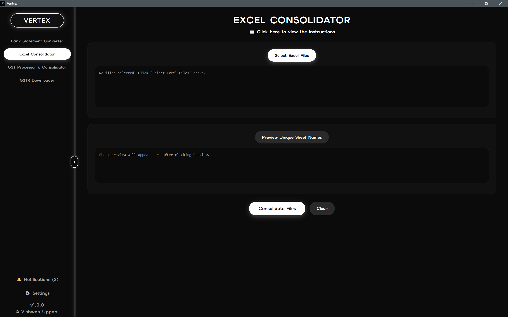
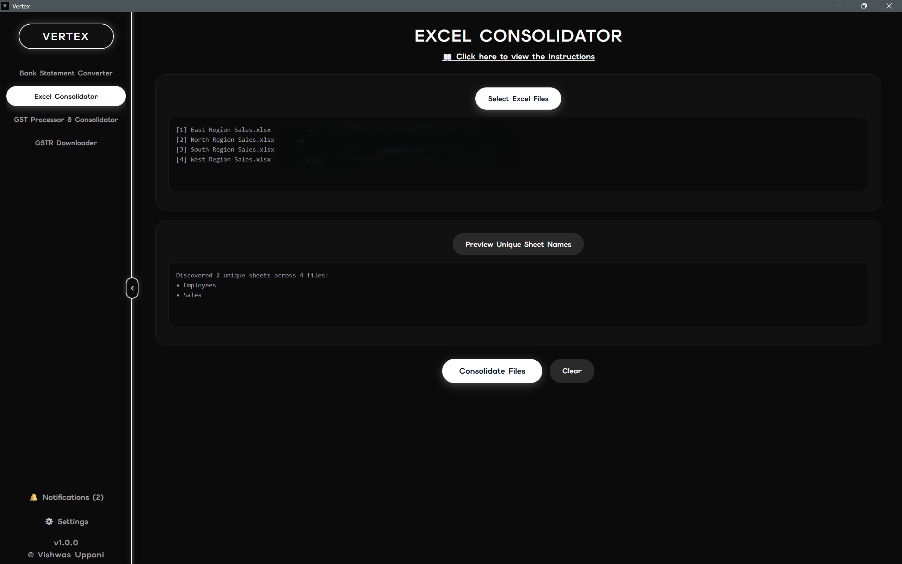
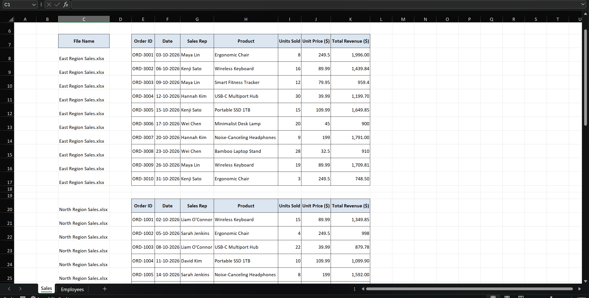

# Excel Consolidator

Excel Consolidator is an official addon module for the **Vertex Application**. It merges multiple Excel workbooks into a single, unified master spreadsheet. Engineered for data management and reporting, it consolidates matching sheets across multiple workbooks, tags source filenames for complete audit traceability, and preserves original cell formatting and merged cell layouts.

> [!NOTE]
> **Internet Usage**: 100% offline. All spreadsheet merging and consolidation run locally on your computer and do not use an internet connection.

---

## 📸 Screenshots

### Consolidator Interface

### Unique Sheet Preview

### Consolidated Master Output

---

## ✨ Key Features

- **📑 Multi-Workbook Batch Merging**: Consolidate multiple `.xlsx` and `.xls` files simultaneously into one structured master workbook.
- **🗂️ Unified Sheet Aggregation**: Automatically groups data by worksheet name, merging data across matching sheets into their respective tabs in the destination workbook.
- **🏷️ Source File Traceability**: Automatically tags source workbook filenames with each consolidated record, ensuring complete audit transparency.
- **🎨 Formatting & Layout Preservation**: Retains cell fonts, borders, background fills, number formats, alignments, row heights, column widths, and merged cell ranges.
- **👀 Unique Sheet Preview**: Quickly inspect all unique sheet names across the selected files before initiating consolidation.

---

## 📥 Installation

### Via Vertex Module Manager (Recommended)
1. Open the **Vertex Application**.
2. Go to **Settings** in the sidebar and then **Module Manager**.
3. Switch to the **Cloud Store** tab, locate **Excel Consolidator**, and click **Install**.
4. The addon will automatically download, install, and appear in your active sidebar navigation.

### Manual Package Installation
1. Download the latest release `.vtx` package from the [Releases](https://github.com/vishwasupponi/vtx-excel-consolidator/releases) page.
2. In Vertex Module Manager, click **"Install Local File"** and choose the downloaded package.

---

## 🚀 Getting Started

1. **Open Tool**: Select **Excel Consolidator** from the sidebar navigation.
2. **Select Excel Files**: Click **"Select Excel Files"** to choose the workbooks you want to merge.
3. **Preview & Consolidate**: Optionally click **"Preview Unique Sheet Names"** to review discovered sheets, then click **"Consolidate Files"** to generate the merged master workbook.

> For more information, check the **Instructions** manual inside Vertex.

---

## 🤝 Contributing & Security

- You are free to develop custom plugins for personal use. To propose a module for the official Cloud Store catalog or submit contributions, see [CONTRIBUTING.md](CONTRIBUTING.md).
- To report a security concern or review the security policy, see [SECURITY.md](SECURITY.md).

---

## 🙏 Acknowledgments

This module is built using various open-source libraries and components under their respective open-source licenses. Building this module would not have been possible without these foundational open-source technologies, and I thank all the original developers and maintainers of these projects for their contributions:

- **[openpyxl](https://openpyxl.readthedocs.io/)** – Multi-workbook Excel spreadsheet reading, cell copying, formatting, and export.
- **[pandas](https://pandas.pydata.org/)** – Fast tabular dataset manipulation, sheet merging, and deduplication.
- **[NumPy](https://numpy.org/)** – Numerical array operations for structured tabular processing.

---

## 📄 License

This project is licensed under the [GNU Affero General Public License v3 (AGPL-3.0)](LICENSE).

Developed by [Vishwas Upponi](https://vishwasupponi.blogspot.com/links).
